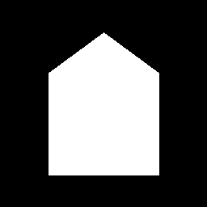
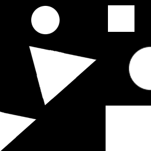
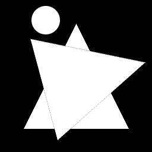

# Mini GenAI Lab

A local educational application for architecture students to explore how training data and model parameters affect image reconstruction and generation. The interface brings together dataset construction, independent Autoencoder (AE) and Variational Autoencoder (VAE) training, reconstruction, generation, interpolation, and comparison.

The models are trained locally from scratch. The application uses 64 × 64 grayscale images and focuses on simple geometry and controlled experiments. It does not require a pretrained image model, an API key, or a paid AI service.

## Download

On this repository page, choose **Code → Download ZIP**, then extract the archive. Open the extracted folder containing `app.py` and `requirements.txt`.

## Requirements

- Python **3.11, 64-bit**. The author's working Windows environment uses Python 3.11.0.
- Internet access for the initial installation of Python packages.
- A writable local project folder for datasets, trained models, and results.

The default Windows installer uses the CPU version of PyTorch, so an NVIDIA graphics card is not required. Training time depends on the computer, dataset size, and training settings.

Direct package versions reported from the author's working environment:

| Package | Version |
| --- | --- |
| Gradio | 6.12.0 |
| PyTorch | 2.9.1 |
| Torchvision | 0.24.1 |
| NumPy | 2.2.6 |
| Matplotlib | 3.10.7 |
| Pillow | 12.0.0 |

These direct dependencies are pinned in `requirements.txt`; transitive dependencies are not fully locked. The author also verified the supplied Windows CPU installer and launcher on their computer. Other computers and operating systems have not been tested for this release.

## Windows: simple installation

1. Install Python 3.11 (64-bit) from [python.org](https://www.python.org/downloads/). Include the Python launcher when installing.
2. Extract the downloaded ZIP completely.
3. Double-click **`install_windows_cpu.bat`**. It creates a `.venv` environment in the project folder and installs the required packages. The initial download may take several minutes. Wait for **Installation completed**.
4. Double-click **`start_windows.bat`** whenever you want to run the application.

The browser opens automatically at **http://127.0.0.1:7860**. Keep the terminal window open while using the app. Close the app by pressing **Ctrl+C** in that window.

VS Code is optional. If you use VS Code, select the interpreter at `.venv\Scripts\python.exe` before running `app.py`.

## Manual installation

Run commands in the folder containing `app.py`.

### Windows (PowerShell or Command Prompt)

```powershell
py -3.11 -m venv .venv
.venv\Scripts\python.exe -m pip install --upgrade pip
.venv\Scripts\python.exe -m pip install torch==2.9.1 torchvision==0.24.1 --index-url https://download.pytorch.org/whl/cpu
.venv\Scripts\python.exe -m pip install -r requirements.txt
.venv\Scripts\python.exe app.py
```

### Linux / macOS (not verified for this release)

```bash
python3.11 -m venv .venv
.venv/bin/python -m pip install --upgrade pip
```

On Linux, install CPU PyTorch first:

```bash
.venv/bin/python -m pip install torch==2.9.1 torchvision==0.24.1 --index-url https://download.pytorch.org/whl/cpu
```

Then install the remaining dependencies and start the app (Linux and macOS):

```bash
.venv/bin/python -m pip install -r requirements.txt
.venv/bin/python app.py
```

For GPU-specific installation, consult the [official PyTorch installation commands](https://pytorch.org/get-started/previous-versions/#v291). The application automatically uses CUDA if a compatible CUDA installation is available; otherwise it uses the CPU.

## First experiment

1. Open **1. Dataset**. Choose the built-in categories and click **Create Built-in Dataset**. Alternatively, upload a simple source geometry and click **Create Dataset from Student Source**. This second route creates variations in position and scale; it does not add rotation.
2. Open **2. Autoencoder** and click **Train Autoencoder**. For an initial check, use a small dataset and a few training epochs; this checks the workflow rather than model quality.
3. Upload a post-training image in the Autoencoder tab and run its reconstruction.
4. Open **3. Variational Autoencoder (VAE)** and train the VAE on the same dataset. The two models train independently. Reconstruct the same post-training image with the VAE.
5. Use **Generate Samples** to create images from sampled latent vectors. Use **Run Latent Interpolation** with two images to inspect the decoded intermediate representations.
6. Open **4. Compare** and click **Compare Latest AE / VAE Reconstructions**. The app loads the saved reconstructions and checks that the input, dataset, and model runs match.

A post-training image used for reconstruction or interpolation is not automatically added to the training dataset. Creating another dataset replaces the current training dataset; train both models again to compare them on that new dataset.

## Included input test images

Three original post-training test images are included **in the main project folder**, next to `app.py`. They provide a common starting point for reconstruction and interpolation.

| House silhouette | Separate shapes | Overlapping shapes |
| --- | --- | --- |
|  |  |  |
| `input_test_house.png` | `input_test_separate_shapes.png` | `input_test_overlapping_shapes.png` |

After training, upload the same chosen file under **Post-training Image** in the AE and VAE tabs, run both reconstructions, then open **Compare**. For interpolation, choose two of these images as Image A and Image B in the VAE tab.

These files are not automatically included in the training dataset. The geometric compositions and house silhouette may differ from the training categories, allowing discussion of what the trained model retains or changes. They are supplied as starting examples, not as a formal evaluation benchmark. The app resizes post-training inputs to 64 × 64 grayscale; use the supplied white-on-black format for comparable experiments.

## Local files

| Path | Purpose |
| --- | --- |
| `app.py` | Complete application and browser interface |
| `requirements.txt` | Direct Python dependencies |
| `input_test_*.png` | Three visible example images for post-training experiments |
| `install_windows_cpu.bat` | Windows installation into a local Python environment |
| `start_windows.bat` | Windows launcher |
| `datasets/` | Training images, source geometry, and dataset configuration |
| `models/` | Trained AE/VAE weights and configurations |
| `outputs/` | Figures, reconstructions, generations, interpolations, and logs |

The application creates the last three directories automatically. This source package starts with no saved datasets, trained models, or previous experiment outputs. The older standalone scripts from the original working archive are not needed by `app.py` and are excluded from this distribution.

In **5. Local Files & Maintenance**, you can open the output folder and clear saved experiment outputs. Clearing outputs deletes their history and preserves the current datasets and trained models. Copy the entire project folder when you want to preserve an experiment before replacing its data or models.

## Troubleshooting

- **Python 3.11 is not found:** install Python 3.11 with its launcher and rerun the installer.
- **A package is missing:** rerun the installer and read any error in the terminal. With VS Code, check that the selected interpreter belongs to this project's `.venv`.
- **The browser does not open:** visit http://127.0.0.1:7860 while the terminal is running.
- **Port 7860 is already in use:** close the earlier running instance of the app, then restart.
- **Training or generation reports missing data/models:** create a dataset first, then train the relevant model.
- **Comparison refuses to run:** train both models on the same dataset and reconstruct the same image with each current model.

## Scope and verification

The application is an educational prototype for investigating relationships between data, parameters, and image outputs. Its results do not establish architectural feasibility or construction performance. Smooth latent interpolation alone does not demonstrate meaningful architectural continuity.

The author confirmed that the original `app.py` runs on their Windows computer with the versions listed above. Packaging checks verified Python syntax and that `app.py` is unchanged. The author subsequently tested the supplied Windows CPU installation and launch instructions and confirmed that the application opens successfully. This confirms installation and startup on that computer; it is not a complete validation of every experimental function or other operating systems.

## Author and research context

Application author: **Sotirios Ntzoufras**  
Affiliation: **Technical University of Crete (TUC), School of Architecture, Chania, Greece**

### Associated paper

**Learning to See as AI Sees: A Generative AI Educational Platform for Architectural Design Pedagogy**

Paper authors: Sotirios Ntzoufras, Marianthi Liapi, Konstantinos-Alketas Oungrinis, and Anastasia-Maria Kyriakopoulou.

The associated paper presents the pedagogical framework, implementation, and planned evaluation. The software makes selected relationships visible: training material, independent AE/VAE training, latent representation, and distinct post-training operations. Reconstruction, generation, and interpolation are different ways of using a trained model. Learning effectiveness has not yet been empirically assessed in the supplied manuscript.

Repository: https://github.com/sotirisntzoufras/mini_genai_lab

## License
This project is licensed under the MIT License — see the LICENSE file for details.
